# shelf · Docker 一键部署

自托管有声书服务器 shelf 的 Docker 部署仓库。

- 运行镜像来自 GitHub Container Registry：**`ghcr.io/subject2019/shelf`**（公开，安装时自动拉取）。
- 本仓库只包含部署所需文件：`docker-compose.yaml` + `.env.example` + 一键安装/卸载脚本，**不含 shelf 源码**。

## 在线实例

- 实例地址：http://123.56.254.152
- 用户名：`shelf`
- 密码：`shelf2026`

> 公开演示账号，仅供体验；请勿存放隐私数据。

## 界面预览

> 截图来自 shelf 示例书库，暗色主题。

### 桌面端（1440×900）

<p align="center">
  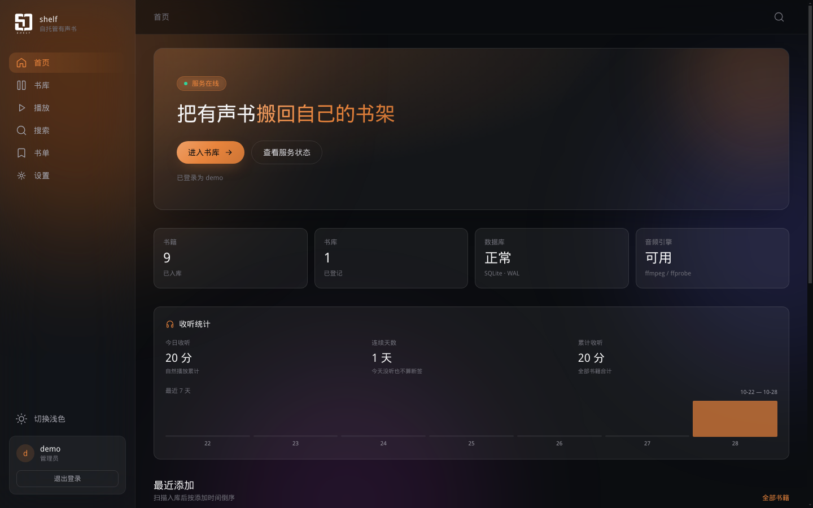
  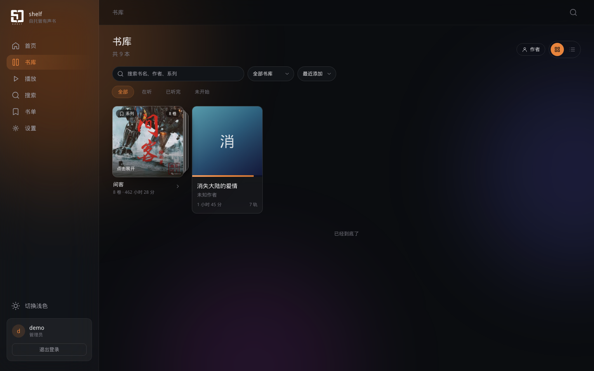
</p>
<p align="center">
  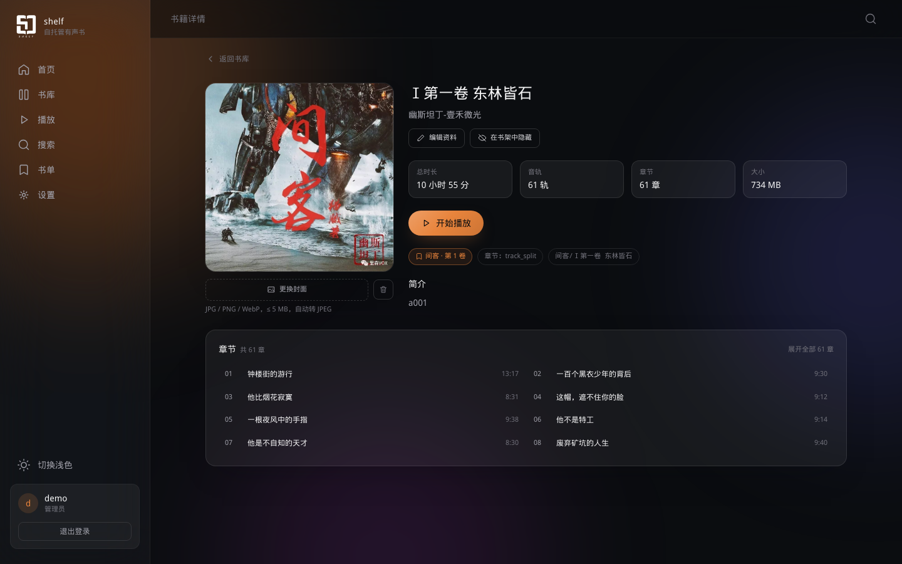
  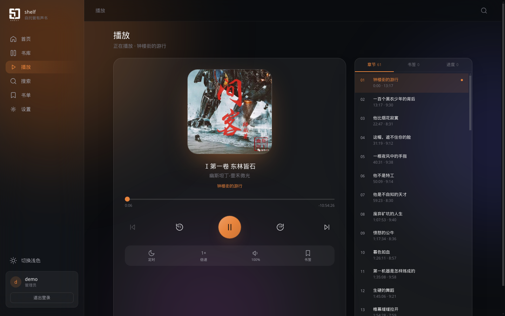
</p>
<p align="center">
  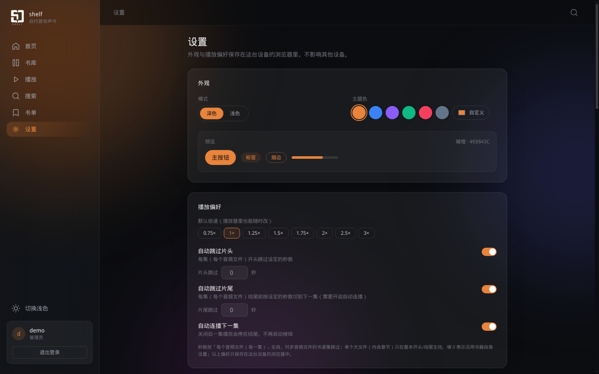
  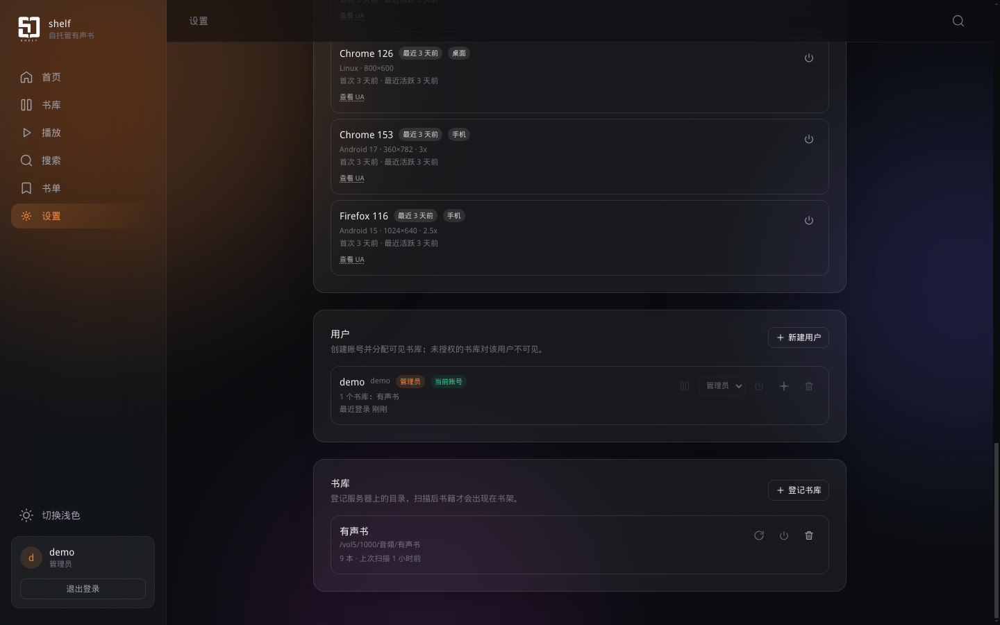
</p>
<p align="center">
  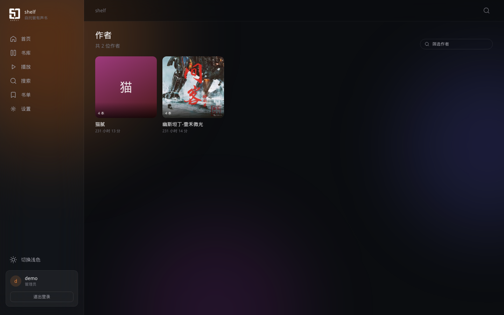
</p>

### 手机端（390×844）

<p align="center">
  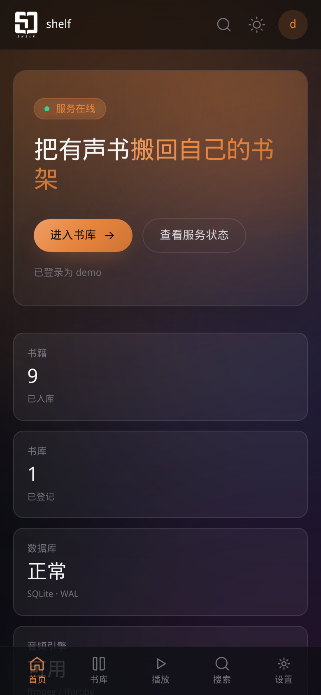
  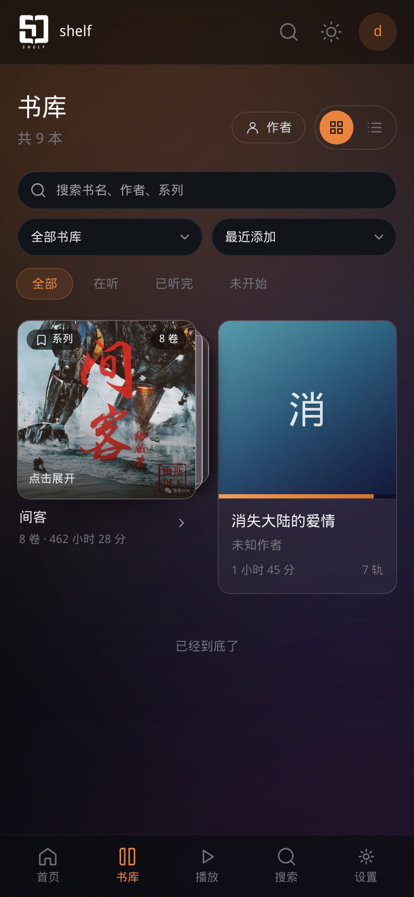
  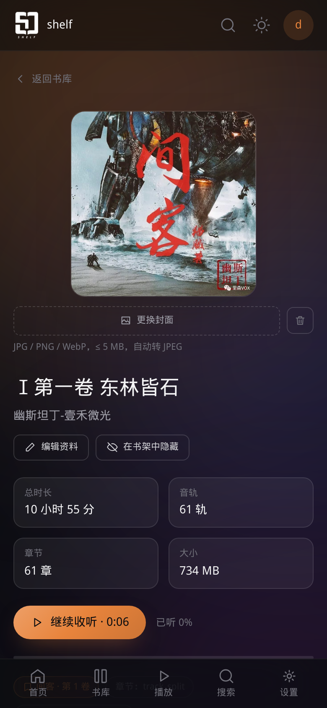
</p>
<p align="center">
  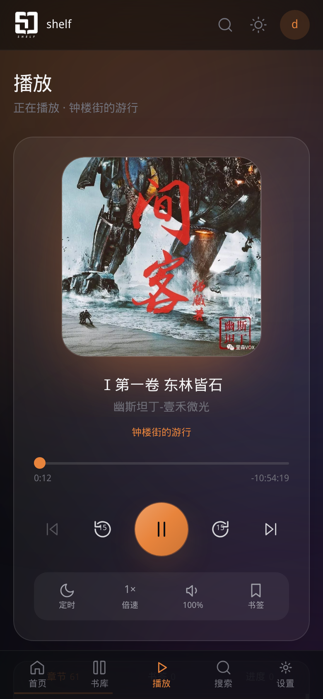
  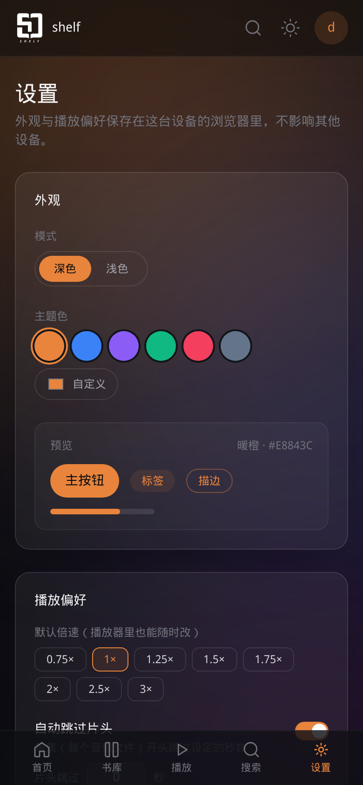
</p>

## 环境要求

- Docker ≥ 20.10，且 Docker Compose v2（`docker compose` 命令可用）。

## 快速开始（推荐）

克隆后直接跑一键脚本：

```bash
git clone https://github.com/subject2019/shelf-docker.git shelf-docker && cd shelf-docker
bash install.sh
```

脚本会依次询问：媒体目录、数据目录、管理员用户名、映射端口、管理员密码（留空则随机生成），然后自动拉取镜像并启动。
完成后浏览器打开 `http://<本机IP>:<映射端口>/`（默认 8080），用设置的管理员用户名/密码登录；网页端「设置 → 书库」添加 `/audiobooks`。

> 脚本依赖同仓库的 `docker-compose.yaml` 与 `.env.example`，请在仓库根目录运行，不要单独取出 `install.sh` 执行。

## 手动部署（docker run）

```bash
docker run -d --name shelf -p 8080:8080 \
  -v /你的媒体目录:/audiobooks:ro \
  -v /你的数据目录:/data \
  -e ECHOSHELF_ADMIN_USERNAME=admin \
  -e ECHOSHELF_ADMIN_PASSWORD=你的密码 \
  ghcr.io/subject2019/shelf:latest
```
把 `-p 8080:8080` 的第一个 8080 换成你的宿主机端口即可自定义访问端口；用 `admin`（或自定义用户名）与上面设置的密码登录。

## 卸载

```bash
bash uninstall.sh
```

会停止并移除容器，并询问是否一并移除镜像与数据目录（数据目录删除不可逆，默认保留）。

## 环境变量

详见 `.env.example`，关键项：

| 变量 | 默认 | 说明 |
|---|---|---|
| `AUDIOBOOKS_PATH` | `/volume1/media/audiobooks` | 宿主机媒体目录，**必改**；容器内固定 `/audiobooks:ro` |
| `ECHOSHELF_DATA_PATH` | `/volume1/docker/shelf` | 数据库/缓存，必须本地盘 |
| `SHELF_HOST_PORT` | `8080` | 宿主机映射端口（容器内固定 8080） |
| `ECHOSHELF_ADMIN_USERNAME` | `admin` | 初始管理员用户名（自动转小写） |
| `ECHOSHELF_ADMIN_PASSWORD` | 空 | 初始密码（≥8 位），或改用 `ECHOSHELF_ADMIN_PASSWORD_FILE` |
| `ECHOSHELF_ALLOW_REGISTRATION` | `false` | 自助注册开关 |
| `ECHOSHELF_ENABLE_TRANSCODE` | `true` | 弱机器建议关闭 |
| `PUID` / `PGID` | `1000` | 运行身份，需对媒体目录有读权限 |

## 数据持久化

- 数据库/缓存：`${ECHOSHELF_DATA_PATH}`，卸载后保留，删除即彻底清理。
- 媒体库：`${AUDIOBOOKS_PATH}` 只读挂载。
